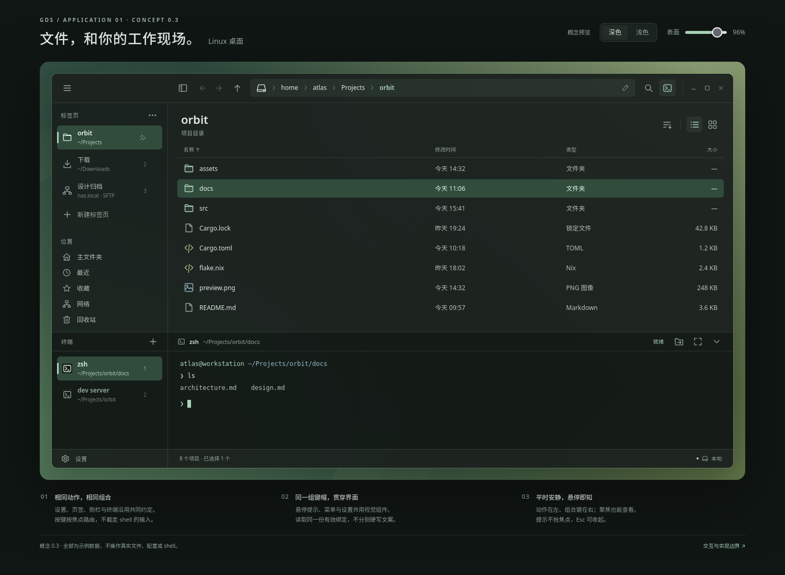

# GDS Files · Linux 文件浏览器概念设计

本文保留 0.3 的完整交互目标；原生 App 已开始实现，当前能力见 [开发与运行说明](../../development.md)。以下原生修订优先于历史 HTML / PNG：文件视图使用 DataTable；侧栏使用统一条目与连续材质；设置从菜单或 Ctrl+, 进入，次级页左上使用返回箭头；设置即时应用，下拉框、滑块与逐项恢复默认遵循 [共享设置规则](../../settings/README.md)。历史预览不再扩建。

## 1. 设计结论

**一个目录就是一个可持续的工作上下文；路径在上，标签在侧，终端在下。**

- 窗口采用一个公共网格；文件标签与终端竖向页签共用侧栏列宽和分界，可一起折叠成窄轨。
- 全宽顶栏位于所有侧栏上方；主页面最左为应用菜单，次级页面同位置为返回箭头。分界右侧安排侧栏折叠、导航与可编辑路径，不放 Files / 文件夹品牌标识。
- 下方全宽终端 dock 使用用户的 shell 和正常配置；每个文件标签拥有自己的终端会话集合与活动会话，外部终端入口同时保留。
- 最底部保留 36 px 对齐区域；左侧延续侧栏材质并留白，不放设置按钮；右侧显示状态信息。
- 所有颜色、材质、图标语义、组件状态与相似动作的快捷键来自公共层。参见 [视觉语言](../../vistual-language/README.md)、[共享主题](../../vistual-language/theme.md)、[快捷键与键帽](../../vistual-language/shortcuts.md) 及 [设置中心](../../settings/README.md)。

## 2. 概念预览

[打开交互原型](concept.html) · [深色图](concept-dark.png) · [浅色 / 折叠图](concept-light.png) · [设置中心图](concept-settings.png) · [快捷键悬停图](concept-shortcuts.png) · [快捷键设置图](concept-keybindings.png)



0.3 原型沿用深浅色与透明度、共享侧栏、文件导航、筛选、右键菜单、完整设置中心及多会话终端；本轮示范五个核心动作、统一 ShortcutBadge 与按钮 hover 布局，并增加文件标签关闭演示（存在终端会话时确认）。终端保留竖向页签、整个 dock 的显隐 / 最大化和显式目录跳转示意。它是无外部依赖的 HTML 设计载体，**不意味着实际应用采用 WebView**。

所有目录、网络位置与终端输出均为示例；它不读取真实文件、不接入桌面主题、不运行 shell。终端目录跳转只是状态演示，不证明真实 shell 已执行或改变 cwd；设置表单不写真实配置。实际文件操作、完整普通编辑快捷键、完整菜单、文件标签拖拽、图标视图、真正的搜索与网络连接未在本轮原型中实现。宿主浏览器可能截获新建 / 关闭窗口等保留键；按钮演示不等于真实 GPUI 键盘验收，详见 [原型快捷键边界](../../vistual-language/shortcuts.md#7-03-原型范围与验收)。

**设计范围已收敛：**收藏、固定和最近记录只补示意。后续以原生 GPUI App 为交付，不继续扩展预览网页的功能或测试体系。

### 布局骨架

```text
┌────────────────────────────────────────────────────────────────────────┐
│ ☰  空白拖动区      折叠  ← → ↑  / home / atlas / Projects / orbit   >_ ⋯ │
├─────────────────┬──────────────────────────────────────────────────────┤
│ 文件标签        │ orbit                       排序 / 列表 / 图标        │
│ ▌orbit  固定 ×  │ 名称                      修改时间      类型    大小  │
│  下载        ×  │ assets/                                               │
│  设计归档    ×  │ docs/                  文件列表 / 缩略图视图           │
│  ＋ 新标签页    │ src/                                                  │
│ 位置            │ …                                                     │
│ 主文件夹 / 最近 │                                                       │
│ 收藏 / 网络     │                                                       │
│ 回收站          │                                                       │
├─────────────────┴──────────────────────────────────────────────────────┤
│ 终端会话   ＋      zsh · ~/Projects/orbit   跳转到当前文件夹  放大 / 收起 │
├─────────────────┬──────────────────────────────────────────────────────┤
│ ▌zsh · orbit ×  │ 当前活动终端会话                                      │
│  zsh · docs  ×  │ ❯                                                     │
│                 │                                                       │
├─────────────────┴──────────────────────────────────────────────────────┤
│                    项目数 / 选择信息                     位置 / 任务状态 │
└────────────────────────────────────────────────────────────────────────┘
```

### 共享对齐与显隐

- 唯一侧栏列宽为 `--sidebar-width`：展开约 **222 px**，折叠 **58 px**。上方文件标签与下方终端页签使用相同宽度和竖向分界；不分别计算两套侧栏尺寸。
- 全宽顶栏主页面最左是应用菜单，设置等次级页改为返回箭头，后方留空作拖动区。侧栏折叠按钮位于列分界右侧；顶栏在分界处**不画竖线**，也不显示 Files 文字或文件夹品牌图标。
- 文件区是左侧文件标签 / 位置、右侧内容；终端 dock 横跨全宽，左侧竖向会话页签、右侧会话视图，头部横线贯穿两列。
- 终端默认占工作区高度约三分之一。拖动调整、隐藏和最大化都以整个 dock 为单位，左页签、头部与右内容一起变化；最大化占用文件工作区，保留公共顶栏与底栏。隐藏保留所有会话，恢复时回到原活动会话与尺寸。
- 公共底部区域固定 **36 px**；左侧是连续的侧栏留白，不画分割顶线，右侧显示状态。整条左列只绘制一次同样的背景，不叠内容底色。菜单 / Ctrl+, 打开 [完整设置中心](../../settings/README.md)，没有底部设置入口或保存栏。
- 窄窗口优先折叠共同侧栏、收起次要工具，不压缩路径与文件名到不可读。窗口按钮和拖动行为遵循平台能力，原型窗口按钮只是示意。

## 3. 纵向标签：打开的工作上下文

### 内容与生命周期

每个文件标签保存自己的位置、历史、视图方式、排序、滚动位置、文件选择、搜索状态，以及**终端会话集合和当前活动会话**。切换文件标签时展示它自己的终端页签与活动会话，不串用另一个标签的会话；未显示的会话继续保留。

标签可以指向本地目录、已支持的网络 URI、挂载卷、回收站或搜索结果。内部位置模型不能只有 `PathBuf`；UI 也不能因为后端不同就换一套标签交互。

- 单击标签切换；新建默认进入主目录。中键、关闭按钮或公共“关闭当前页签”动作可关闭标签；关闭当前标签后选中相邻标签，含终端会话时保留确认，取消则不改变上下文。键盘动作只针对所属 scope 的当前页签，不能由鼠标悬停目标代替。
- 拖动排序；目录中键，或选中目录后 `Ctrl+Enter`，在新标签页打开。文件视图的 Ctrl+单击仍用于多选，不复用为导航；菜单提供“复制标签”“关闭其他”“重新打开已关闭标签”。
- 同名目录在次行展示父路径 / 服务器；活动标签用强调底色与窄条标识。
- 折叠为图标轨时保留当前态、位置类型与短序号；悬停显示完整名称和路径。标签太多可滚动，通过展开侧栏辨别，不把多个目录压成一排相同图标。
- 关闭最后一个标签显示主目录新标签，不意外退出应用。退出窗口是独立动作。
- 退出后可恢复标签位置与视图，不声称恢复正在运行的 shell 进程。远程位置恢复时按需连接，不因启动应用就并发弹出一堆认证框。

### 标签、设备与位置明确分区

侧栏现行设计分为标签页、设备、位置三块；标签页为上半区，设备与位置合用下半区，两区之间可拖动调整高度。设备接入、挂载、安全移除及滚动规则见 [设备接入与侧栏设计](devices-and-sidebar.md)，该文档优先于本文历史布局示意。

位置分组内依次为**主文件夹、最近、收藏、网络、回收站**。它们是位置 / 集合入口，不是不可关闭的隐藏标签；默认在当前标签打开，Ctrl+单击开新标签。首版不再引入常驻目录树。

| 概念 | 含义与示意 |
| --- | --- |
| 收藏 / 书签 | 星形标记，保存常用目录或网络位置；关闭标签不删除收藏。菜单提供“收藏当前位置”，集合内可移除收藏，不删除文件。 |
| 固定标签（置顶） | 图钉标记，固定标签排在普通标签之前；“关闭其他标签”保留它们。仍可显式关闭，涉及终端会话时沿用确认。固定不是收藏，也不是窗口总在最前。 |
| 最近 | 时钟标记，按最近打开时间列出本应用访问过的文件、目录或网络位置；可移除记录 / 清空记录，不删除原文件。不承诺导入系统全部历史。 |

原型仅补入口、菜单文案和一个已固定标签的静态标记；不实现收藏持久化、历史采集或固定标签管理逻辑。这些行为在实际 App 中实现。

## 4. 顶部路径与导航

- **浏览态：**每个面包屑段可点击，进入对应祖先目录；当前位置仍可辨认。过长时折叠中间段，省略入口可展开完整祖先列表。
- **编辑态：**点击空白区域 / 编辑图标，或 `Ctrl+L`，切换到整条可编辑路径并选中。面包屑点击始终负责导航，不兼做编辑。
- `Enter` 解析并尝试导航；`Esc` 取消，回到原路径。支持绝对路径、`~/` 和已支持的 URI，不把输入作为 shell 命令执行。
- 不存在、权限不足、网络离线或协议不支持时保留原视图，给出短原因与可修正输入；不能展示一个伪装成功的空目录。
- 后退 / 前进属于当前标签历史；“上级”按位置语义计算，不对所有 URI 简单截断最后一个斜杠。
- 复制路径 / URI 保留完整值；显示时不能暴露 URI 中的密码。普通打开使用桌面默认应用，不擅自执行可执行文件。

## 5. 文件视图与常用操作

首版提供列表与图标两种视图。列表主列为名称、修改时间、类型、大小，可排序；图标视图适合图片与内容浏览，缩略图加载不能阻塞导航。隐藏文件默认隐藏，通过 `Ctrl+H` 切换。

- 默认单击选中、双击 / Enter 打开；Ctrl 切换选择、Shift 连续选择、框选与全选遵循桌面习惯。
- 重命名为原位编辑；包含后缀的文件优先选择主文件名，不悄悄修改扩展名。
- 文件复制、移动、删除、拖放形成任务，持续显示进度 / 失败 / 取消能力。关闭标签不自动取消已提交的文件任务。
- 粘贴遇到同名项目时，用对话框提供经过检查的不重名建议，用户可以编辑新名称或取消；不提供覆盖或合并。多项冲突逐项决定，最终提交仍原子不覆盖；名称被并发占用时重新提示，不能静默替换。
- 删除优先移至回收站。后端不支持回收时不能静默变成永久删除，应明确说明并确认。恢复操作仅在回收站可用。
- 拖放显示将要执行的复制 / 移动 / 链接操作；能力不支持时拒绝，不先显示成功。跨文件系统移动必须等待复制完成后才能删除源。
- 搜索入口明确作用域：当前位置及其子目录。快速名称筛选与递归搜索不能用同一个隐含行为；大型目录 / 网络搜索需要可取消与结果位置提示。
- 大目录的枚举、排序与缩略图后台处理，视图按需呈现。空目录、正在加载、无权限、离线、部分失败是不同状态。

### 网络位置是首版需求，不是伪装成本地路径

首个可用版本目标包含通过成熟系统后端支持的 SFTP / SMB 位置及已挂载目录；优先评估 **GIO / GVfs** 的枚举、文件操作、挂载和认证能力，不自行重写协议栈。GPUI 是 UI 技术，不妨碍使用这些无 GTK 界面的系统服务。

这是一项待实现和验证的后端选择，不是对任意发行版的现成支持承诺：NixOS 打包需明确可用的 GVfs 服务与协议支持；缺少后端时界面提示安装 / 配置需求。列表、搜索、复制、回收、重命名、监视和终端 cwd 的可用性都按位置能力决定。不要为远程对象显示实际不能执行的菜单。

## 6. 右键菜单

右键选中未被选中的目标；右键已有多选中的项目保留多选，菜单作用范围清楚。无意义的动作隐藏；用户能预期存在但暂不可用的动作禁用并解释。

| 上下文 | 首版主要动作 |
| --- | --- |
| 空白区域 / 当前目录 | 新建文件夹、新建空文件、粘贴、在此打开终端、在外部终端打开、排序 / 视图、显示隐藏文件、刷新、目录属性 |
| 单个目录 | 打开、在新标签页打开、在新窗口打开、在此打开终端、在外部终端打开、剪切、复制、复制路径、重命名、移到回收站、属性 |
| 单个文件 | 打开、打开方式、剪切、复制、复制路径、重命名、移到回收站、属性；终端定位到其父目录 |
| 多选 | 打开（适用时）、剪切、复制、复制路径、移到回收站、汇总属性；首版不将单文件重命名伪装成批量重命名 |
| 标签 | 新建、复制、关闭、关闭其他、重新打开已关闭标签；复制位置 |
| 回收站项目 | 恢复、永久删除、属性；永久删除独立确认 |

常规列表的永久删除采用明确命名的次级动作 / `Shift+Delete`，始终确认，不与“移到回收站”共用含糊的“删除”文案。属性包含类型、大小、位置、时间和权限；权限修改受后端与当前用户权限约束，不默认提权。

压缩 / 解压、校验和、批量重命名、双栏文件视图可随后增加，不占用第一版工具栏和主要菜单。

## 7. 终端：真实 shell，而非嵌入外部窗口

### 两个入口都保留

1. **在此打开终端**：在目标目录新建真实 PTY 会话，加入当前文件标签的会话集合并激活，同时展开整个底部 dock；不修改已有会话的目录。
2. **在外部终端打开**：启动用户选择的终端模拟器；适合已有独立终端工作流。

空白区域使用当前目录；目录项使用该目录；文件项使用父目录。多选目录时不悄悄选择其中一个，隐藏该动作或要求明确目标。没有本地可访问路径的网络 URI 不能充当本地 cwd：该入口说明不可用；远程 SSH shell 不是这次自动附带的功能。

### 依赖分工

```text
用户 shell / 程序  ⇄  PTY  ⇄  终端模拟核心  ⇄  GPUI 绘制与输入
                                        │
                               GDS 主题 / ANSI 调色板
```

优先评估 `alacritty_terminal` 的成熟解析与屏幕模型。PTY 可以走它的 Unix tty / event loop，也可以选 `portable-pty` 配合屏幕核心，**只选一条 I/O 路线**。不要仅接一个 ANSI 解析器就把它称作完整终端；光标、滚屏、宽字符、alternate screen、选择、IME 与键盘输入都是真实终端职责。

Zed 可借鉴交互与 GPUI 输入 / 渲染方式，但它的 `terminal`、`terminal_view` 是 GPL-3.0-or-later，且耦合多个应用 crate，不能因 GPUI 本身使用 Apache-2.0 就直接认定整块终端可复用。若 TTY7 指的是 `l0ng-ai/tty7`，可参考其 GPUI + Alacritty + PTY 的分层；本次不引入其 daemon、SSH 工作台或定制 fork 集合。

### 用户的 shell 与配置

- 来源顺序：用户显式设置 → 有效 `$SHELL` → 账户数据库中的 shell。不硬编码 `/bin/bash`。
- 使用真实 PTY，Linux 默认交互式、非 login；提供 login 选择与显式参数。不同 shell 的参数 / 启动规则不同，不能统一追加 `-il`。
- 保留登录会话的必要环境和 `HOME`、`XDG_CONFIG_HOME`、`ZDOTDIR` 等位置，让 shell 自己读取 rc / profile。GDS 不解析、复制、改写或手工 source 用户配置。
- 在进程启动时设置 cwd，不拼接 `cd <path>` 命令。目录失效 / 无权访问时说明失败，不静默换到主目录；用户 rc 主动切换目录则尊重它。
- 终端字体、ANSI 颜色和按键设置属于 GDS 的共享终端配置；“使用用户 shell 配置”不等于自动支持所有 Kitty、Alacritty 或其他模拟器的配置格式。
- PTY resize、UTF-8 / 中文宽字符、IME、bracketed paste、常见 TUI 是嵌入终端可交付前的必要验证；不谎报内核尚未支持的终端能力。

### 会话集合与竖向页签

- 每个文件标签持有自己的终端会话集合与活动会话。终端页签竖向置于 dock 左侧，支持切换、新建和结束；右侧只展示活动会话。
- 新建会话默认使用当前文件标签的浏览目录，不取选中的子目录；右键“在此打开终端”则使用其明确目标。活动会话结束后选择相邻会话；集合为空时保留 dock 并显示创建提示，不自动再启动一个 shell。
- 顶栏终端按钮只切换整个 dock 的显隐，空集合也不隐式创建。收起 / 切换标签 / 打开设置只隐藏相关视图，保留所有 PTY、cwd、环境、作业、选择与滚屏。
- “收起 dock”与“结束会话”是独立动作。关闭含仍在运行会话的文件标签 / 窗口时，明确询问是否结束这些会话，可取消关闭；恢复标签不复活旧进程。
- **文件导航不自动发送 `cd`；shell 自己 `cd` 也不强制文件视图跳转。** 两种位置保持独立，目录同步只由下面的显式动作发起。
- 退出应用后继续运行需要用户明确要求的 tmux / 后台服务方案，不为初版预先增加 daemon。

### 显式“跳转到当前文件夹”

终端工具栏提供此动作，作用于**当前活动终端会话**；目标是当前文件标签正在浏览的目录，不是选中的文件或子目录。它改变已有会话，与始终新建会话的“在此打开终端”不同。

真实 shell 进程的 cwd 不能由文件浏览器在外部简单调用 `chdir` 改变。只有已支持的 shell 集成能确认 shell 位于**空闲且输入为空的提示符**时，才使用该 shell 支持的方式和正确的路径引用请求目录切换：

- shell 忙碌、状态不明或存在未提交命令时，不自动注入、不清空输入、不中断前台程序；提供“在当前目录新建会话”作为替代。
- 对尚不明确支持的 shell，可展示待用户确认的命令；不自动执行，也不为此建立通用 shell 框架。
- URI 没有可用的本地 cwd 时解释不可用，不把远程 URI 当成本地路径。
- 只有确认 shell 报告切换成功后才更新已确认的会话目录；失败或无法确认时保留原显示 / 标记未确认，不先把 UI 改成目标路径来虚报成功。

外部终端启动使用共享系统集成层，尊重用户配置的可执行程序与参数数组，不能假定每个终端都有相同 `--working-directory` 参数。可检测 `xdg-terminal-exec`，但它不是所有 Linux 都已安装的统一保证。NixOS 中路径来自配置 / PATH，不手拼发行版固定路径。

## 8. 快捷键与焦点

默认绑定、键帽与 tooltip 视觉、无障碍、数据来源和完整焦点规则统一见 [快捷键与键帽](../../vistual-language/shortcuts.md)，本应用不再复制一张长期分叉的快捷键表。文件按钮、菜单右列和“设置 → 快捷键”使用同一 Badge；提示中的绑定必须对应当前有效 scope 与按钮目标，非活动文件标签关闭按钮不能暗示“关闭当前页签”会作用于它。

文件工作区的页签动作管理文件标签，终端页签栏聚焦时同语义动作管理终端会话；**终端文本输入不是终端页签栏焦点**。输入框原生编辑保持不变，设置也不是可关闭文件页签。设置与终端显隐按公共窗口级契约处理，其余文件动作不能抢走 shell 输入。

关闭文件标签时，按第 3 节选择相邻标签 / 保留最后标签行为，且不绕过所含会话的确认；关闭终端页签时，按第 7 节结束当前会话并保留空集合提示。原型只演示这些状态，完整 GPUI 按键分发与真实终端仍需验证。

## 9. 落在现有项目约定中的组织

保持一个大 lib，公共代码在二进制目录之外；各应用入口和专用逻辑放在对应二进制目录。不改为多 crate 框架，不使用 `mod.rs`。

```text
src/lib.rs                   公共库入口
src/theme.rs + theme/        来源适配、语义快照和 Kit 桥接
src/ui.rs + ui/              图标词汇、公共组件、共享网格与应用框架
src/ui/settings.rs          套件设置行与数值滑块
src/bin/files/settings/     Files 偏好模型、页面和配置存储
src/bin/files/storage/      卷发现、容量查询与挂载操作
src/desktop.rs + desktop/    默认应用、内容图标、外部终端等系统集成
src/terminal.rs + terminal/  PTY / 屏幕 / GPUI 视图与终端能力
src/bin/files/main.rs        Files 入口
src/bin/files/navigation.rs  位置、标签与导航历史
src/bin/files/directory.rs   目录模型、枚举与视图
src/bin/files/operations.rs  文件任务、冲突与回收站
```

以上是职责划分草案，不是本次创建的源码。设置导航、`settings/pages/` 下的完整页面目录和作用域集中见 [设置中心](../../settings/README.md)，不在各模块重复维护设置页。Files 的行为与文件操作仍在其二进制目录中，公共设置表单通过值 / 回调连接，不依赖二进制模块，也不引入插件系统。

只在功能实施时建立相应模块；通用代码必须能在不依赖 Files 的情况下使用，文件业务也不因为“将来可能复用”就全部塞进公共 UI 库。

- **GPUI Kit** 提供行为基础 / 组件，优先复用侧栏、面包屑、输入框与菜单。GDS 薄层负责共享词汇和主题桥接，而不是重写整套控件。
- **gds-uim** 的 `el!` / `m!` 负责组织 Rust UI 表达，不承担状态管理或主题来源发现。
- 使用同一个选定 GPUI 版本体系，避免 Kit、宏示例与终端候选引入不同 GPUI 身份；概念阶段不锁定依赖版本。
- 应用文案使用 **Mozilla Fluent**；Kit 内部目前另有本地化机制，需要同步 locale，不宣称两者自动共用翻译资源。

## 10. 实施顺序与验收

| 阶段 | 交付 | 看得见的通过条件 |
| --- | --- | --- |
| A：公共视觉垂直切片 | 共享网格、主题、图标、组件、统一动作绑定与 Badge、完整设置中心；Qt / DMS 读取；两处示例视图 | 换主题和材质后两处一致，边线与基线对齐；快捷键四处同源、焦点目标正确；设置作用域明确且返回保留上下文；来源失败可见，不写桌面配置 |
| B：Files 基本可用 | 纵向文件标签、路径、列表 / 图标、常规操作与任务、外部终端 | 文件操作结果正确；焦点和每标签状态稳定；大目录不阻塞交互 |
| C：Linux 完整首版 | 已选网络后端、回收 / 冲突能力、多会话内嵌终端与显式目录跳转 | 网络位置真实可用；用户 shell / rc 正常；dock 整体显隐 / 最大化，隐藏保活；忙碌与未知状态不注入；目录成功后才更新；权限失败可解释 |

B 是阶段性可用构建，不将它冒充已经满足网络与内嵌终端的完整首版。C 的终端需要单独投入，不作为“顺手嵌一个窗口”的小改动。

### 设计验收场景

- 浅色 / 深色、展开 / 折叠、终端显示 / 隐藏 / 最大化、网络 / 本地都保持同一视觉语言；两组左页签共用列宽与分界，终端头线贯通，36 px 底栏左右同线同基线，顶栏不出现分界竖线。
- 同时打开三个同名目录仍能区分；切换文件标签保留历史、选择、滚动位置及各自的终端会话集合 / 活动会话。
- 终端竖向页签可切换、新建、结束；空集合只显示创建提示；隐藏整个 dock 后所有会话仍保留，最大化不留下孤立左栏。
- 设置入口可到达完整多页中心，返回保留文件与终端上下文；设置页的导航、作用域与复用验收见 [设置中心](../../settings/README.md)。
- 五个核心动作、按钮提示、菜单右列与设置绑定列遵循 [统一快捷键验收](../../vistual-language/shortcuts.md#7-03-原型范围与验收)；文件 / 终端页签关闭不绕过确认，非活动目标不伪报绑定，终端文本不被文件动作截获。
- 面包屑导航、路径编辑、路径失败与长路径不会互相破坏。
- 多选、同名冲突、取消复制、无回收能力、网络断开不会显示误导的成功结果。
- 路径含空格 / 非 ASCII 时“在此打开终端”仍以正确 cwd 新建会话，未经 shell 字符串拼接；不改已有会话。
- “跳转到当前文件夹”只针对活动会话，使用浏览目录而非选中子目录；空闲且空输入、忙碌、未知状态、未提交命令、无本地 cwd 与切换失败均得到正确反馈，不中断作业或虚报成功。
- 普通目录导航不向 shell 注入字符；中文输入、resize 与 TUI 正常。

## 11. 已定决策与待确认偏好

0.3 沿用已确定的共享网格、两组竖向页签、完整设置中心与终端会话 / 目录行为，并确定全套件相似动作同绑定、统一键帽和提示、窗口级与焦点级的分发契约。默认绑定以 [快捷键与键帽](../../vistual-language/shortcuts.md) 为唯一表，不再将这些规则列为待确认选项。

以下偏好仍会影响下一步实现：

1. DMS 是否确指 DankMaterialShell，以及实际版本、Qt 后端与使用的合成器？这决定第一套实机验收环境。
2. 推荐将终端作为 Linux 完整首版能力，外部终端先落地；是否接受这个实施顺序？
3. 文件默认双击打开是否符合日常使用习惯？

工作名、示例绿色和样例文件均不是最终品牌决定。不要先把某个色板写死成产品风格；需要固定的是用户能学习并迁移的视觉语言。

## 12. 技术依据

- [GPUI Kit](https://github.com/longbridge/gpui-kit)、[gds-uim](https://github.com/4t145/gds-uim)、[Fluent](https://projectfluent.org/)。
- [Kit 侧栏](https://github.com/longbridge/gpui-kit/blob/main/crates/component/src/sidebar/mod.rs)、[面包屑](https://github.com/longbridge/gpui-kit/blob/main/crates/component/src/breadcrumb.rs)、[Linux / Windows 应用菜单](https://github.com/longbridge/gpui-kit/blob/main/crates/component/src/menu/app_menu_bar.rs)。
- [GIO GFile 的 URI 与文件接口](https://docs.gtk.org/gio/iface.File.html)、[GVfs 项目与后端](https://gitlab.gnome.org/GNOME/gvfs)。网络后端是建议选型，尚未在本项目验证。
- [Zed 的 Alacritty 接入](https://github.com/zed-industries/zed/blob/main/crates/terminal/src/alacritty.rs)、[GPUI 终端绘制](https://github.com/zed-industries/zed/blob/main/crates/terminal_view/src/terminal_element.rs)、[terminal 许可证](https://github.com/zed-industries/zed/blob/main/crates/terminal/Cargo.toml)、[terminal_view 许可证与依赖](https://github.com/zed-industries/zed/blob/main/crates/terminal_view/Cargo.toml)。
- [Alacritty 终端库](https://github.com/alacritty/alacritty/tree/master/alacritty_terminal)、[portable-pty](https://github.com/wezterm/wezterm/tree/main/pty)、[TTY7 候选](https://github.com/l0ng-ai/tty7)。
- [Bash 启动规则](https://www.gnu.org/software/bash/manual/html_node/Bash-Startup-Files.html)、[Zsh 启动规则](https://zsh.sourceforge.io/Doc/Release/Files.html#Startup_002fShutdown-Files)、[外部终端启动提案](https://github.com/Vladimir-csp/xdg-terminal-exec)。
